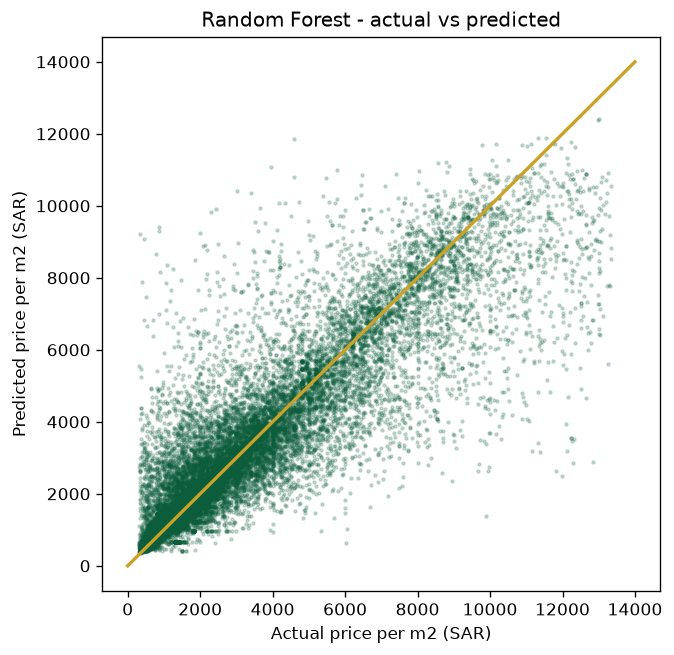
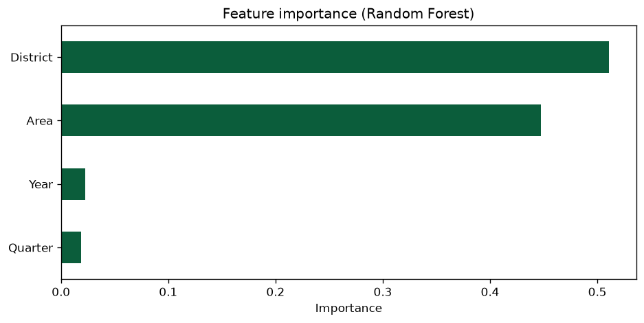

# Riyadh Property Price Prediction (Machine Learning)

A machine learning model that predicts the **price per m²** of residential properties in Riyadh from the **district**, **area** and **date** of the deal.

**Data:** 131,000+ real residential sale deals in Riyadh (2023 - 2025) from the Saudi **Ministry of Justice** open data.
The data was cleaned in my [Saudi Real Estate Market Analysis](https://github.com/abdullrahman-ahmed/saudi-real-estate-analysis) project.

## Steps
1. **Filter:** residential deals with one property each (131K deals after cleaning).
2. **Remove extremes:** the lowest and highest 1% of price per m² (for example symbolic family transfers).
3. **Explore:** price distribution, prices by year, the most expensive districts, and price by property size.
4. **Features:** Area, Year, Quarter and District. Districts are turned into numbers with one-hot encoding; districts with fewer than 100 deals are grouped as "Other".
5. **Train and compare** 3 models on an 80% / 20% train-test split.

## Results

| Model | MAE (SAR/m²) | R² |
|---|---|---|
| Baseline (always predict the average) | 1,926 | 0.00 |
| Linear Regression | 848 | 0.72 |
| **Random Forest** | **618** | **0.80** |

- **MAE** = how far the prediction is from the real price, on average.
- **R²** = how much of the price differences the model explains.

The Random Forest model is about **3 times more accurate** than guessing the average.

## What affects the price?

- **District (51%)** is the most important factor. Northern districts such as Al Malqa, Hittin and Al Nakheel have a median of over 8,000 SAR/m².
- **Area (45%)**: properties under 200 m² cost much more per m² (median 5,267 SAR) than larger ones (about 1,650 SAR), because small properties are mostly apartments.
- The median price per m² rose from **1,538 SAR in 2023 to 2,350 SAR in 2025** (+53%).

## Limitations
The data does not include the property type (land, villa, apartment), age or street width. Adding these would improve the predictions.

## Files
| File | Description |
|---|---|
| `riyadh_price_prediction.ipynb` | The full analysis, with an explanation for each step |
| `data/riyadh_deals.csv` | Riyadh sale deals (cleaned) |
| `figures/` | Charts |

**Tools:** Python, pandas, scikit-learn (Linear Regression, Random Forest), Matplotlib, Jupyter
